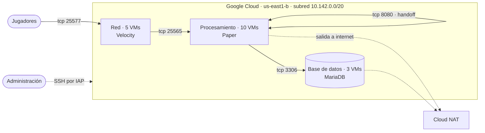

# minecraft-multipaper-gcp

Clúster multi-servidor de Minecraft en Google Cloud: varios proxies
**Velocity** reparten a los jugadores entre servidores **Paper**, con
**MariaDB** como almacenamiento compartido. El objetivo final es un plugin
propio que haga *handoff* de entidades entre los servidores de
procesamiento, para que el mundo se reparta entre varias máquinas.

> **Estado:** en construcción. Los scripts de infraestructura existen pero
> todavía no despliegan de punta a punta, y el plugin no ha empezado. Ver
> [Estado y hoja de ruta](#estado-y-hoja-de-ruta).

## Arquitectura



| Rol | Software | VMs | IP externa | Puertos |
|---|---|---|---|---|
| Red | Velocity | 5 | Sí | 25577 público |
| Procesamiento | Paper + plugin propio | 10 | No | 25565 y 8080, solo internos |
| Base de datos | MariaDB | 3 | No | 3306, solo interno |

- Solo las VMs de red reciben tráfico de internet.
- La administración entra por SSH a través de IAP (no hace falta IP
  externa) y, como alternativa, por un túnel de `cloudflared`.
- Las VMs privadas salen a internet (paquetes, descargas) por Cloud NAT.
- El puerto 8080 queda reservado para el canal de handoff entre servidores
  Paper.

## Tecnologías

- **Google Cloud Compute Engine**, con IAP para SSH y Cloud NAT.
- **Paper** 1.21.4 y **Velocity** 3.4, sobre Java 21.
- **MariaDB** para los datos compartidos.
- **Bash** + `gcloud` para el aprovisionamiento.
- **Cloudflare Zero Trust** (`cloudflared`) para acceso administrativo.

## Estructura del repositorio

```
.
├── infra/
│   ├── README.md                 # guía de despliegue paso a paso
│   ├── deploy.sh                 # orquestador: instala un rol en todas sus VMs
│   └── scripts/
│       ├── tag-instances.sh      # asigna el tag de rol a cada VM
│       ├── internal-firewall.sh  # firewall para tráfico interno
│       ├── wipe.sh               # limpia una VM antes de reinstalar
│       ├── install-common.sh     # base común a todos los roles
│       ├── install-network.sh    # Velocity
│       ├── install-processing.sh # Paper
│       └── install-sql.sh        # MariaDB
└── plugin/                       # plugin Java para Paper (próximamente)
```

## Despliegue

Resumen; los comandos completos están en
[`infra/README.md`](infra/README.md).

1. Etiquetar las VMs por rol.
2. Crear las reglas de firewall: SSH desde IAP, tráfico interno y entrada
   pública a Velocity.
3. Configurar Cloud NAT para las VMs sin IP externa.
4. Ejecutar `infra/deploy.sh` por rol.
5. Aplicar a mano la configuración de Velocity/Paper y el túnel de
   `cloudflared`.

> ⚠️ `deploy.sh` es destructivo: borra y reinstala cada VM, incluida la base
> de datos.

## Estado y hoja de ruta

**Infraestructura**

- [x] Scripts de instalación por rol y orquestador `deploy.sh`
- [x] Etiquetado de las 18 VMs y firewall interno
- [ ] Corregir los fallos que bloquean el primer deploy (ver
      [problemas conocidos](infra/README.md#problemas-conocidos))
- [ ] Configuración de Velocity y Paper desde el repo (`velocity.toml`,
      `paper-global.yml`, `server.properties`)
- [ ] Decidir el papel de las 3 VMs de base de datos (réplicas, una por
      servicio, etc.)

**Plugin**

- [ ] Esqueleto del plugin Paper en `plugin/`
- [ ] Canal de comunicación entre servidores (puerto 8080)
- [ ] Handoff de entidades entre servidores de procesamiento
- [ ] Pipeline de CI/CD para compilar y desplegar el plugin

## Cómo colaborar

1. Crea una rama desde `main` con un nombre descriptivo, por ejemplo
   `fix/ufw-ssh-sql` o `docs/...`.
2. Haz commits pequeños con mensajes que expliquen el porqué.
3. Abre un pull request hacia `main` y pide revisión.

Reglas:

- **Nunca** commitees contraseñas, tokens ni credenciales. La contraseña de
  la base de datos se pasa por la variable `MC_DB_PASSWORD`.
- **Windows:** los scripts `.sh` deben tener saltos de línea de Linux (LF).
  Si Git los convierte a CRLF, fallan con `$'\r': command not found`. Antes
  de clonar, ejecuta `git config --global core.autocrlf input`.
